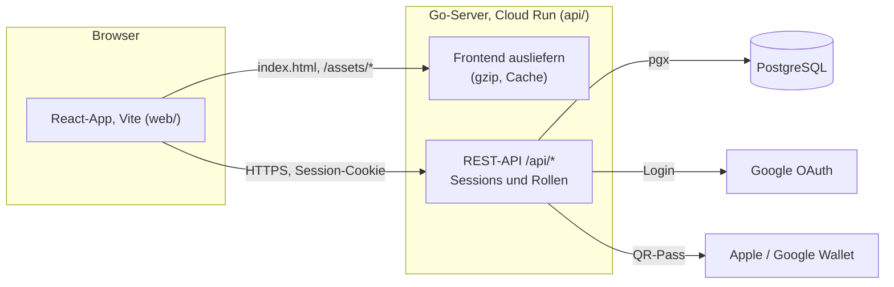
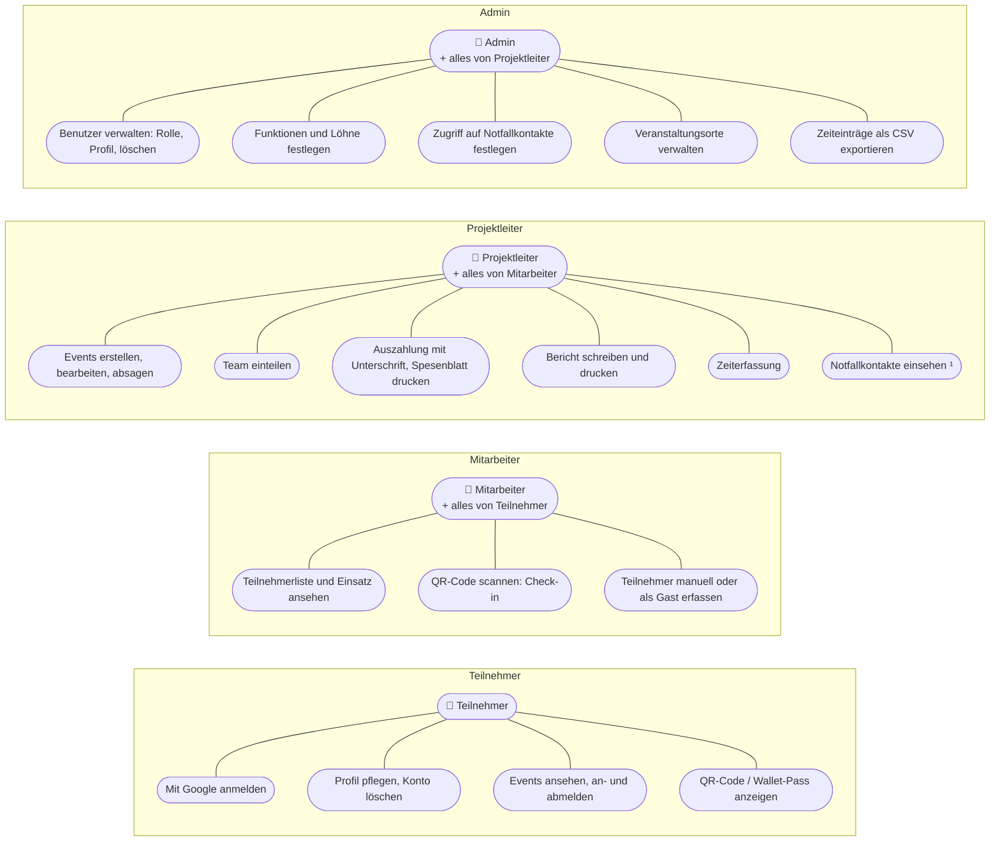
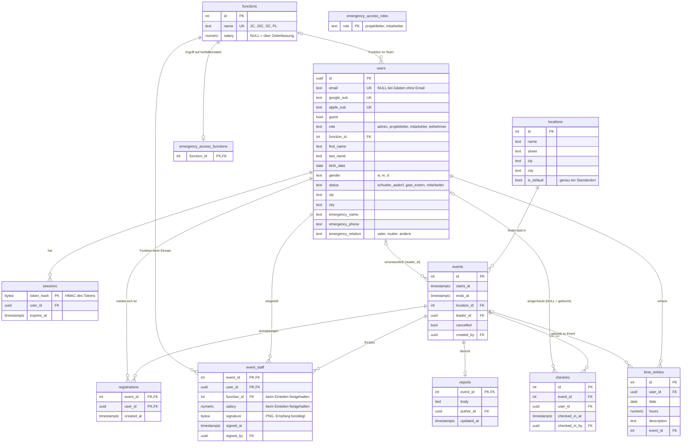
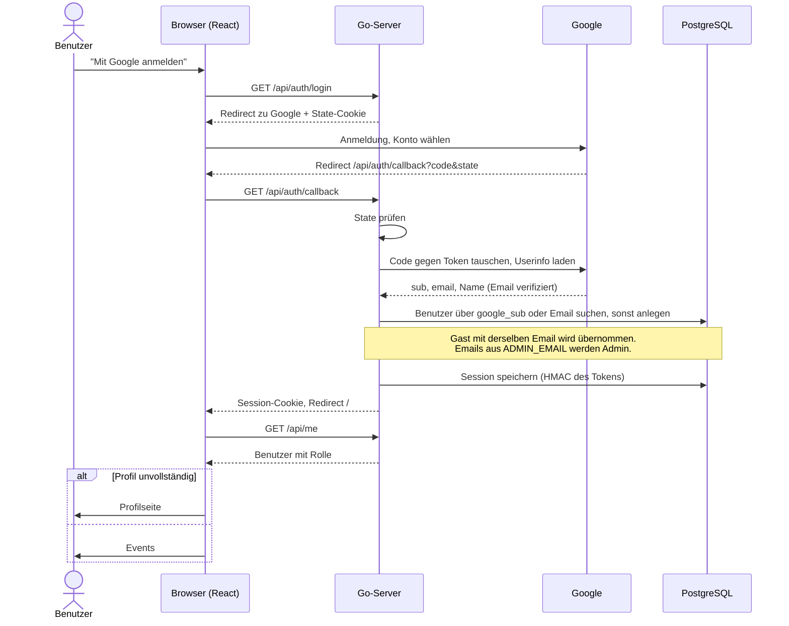
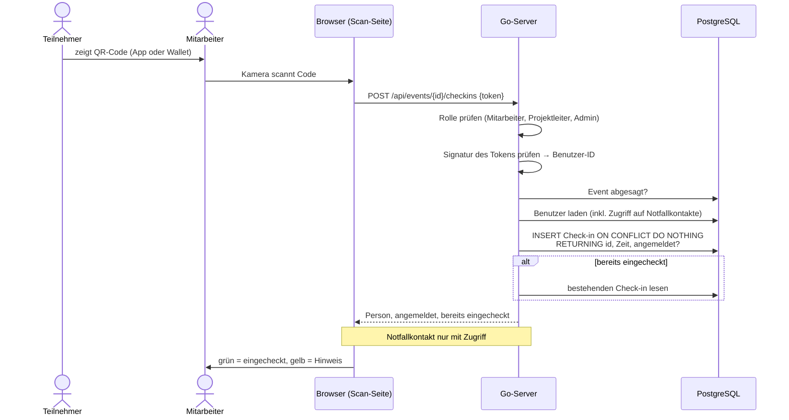
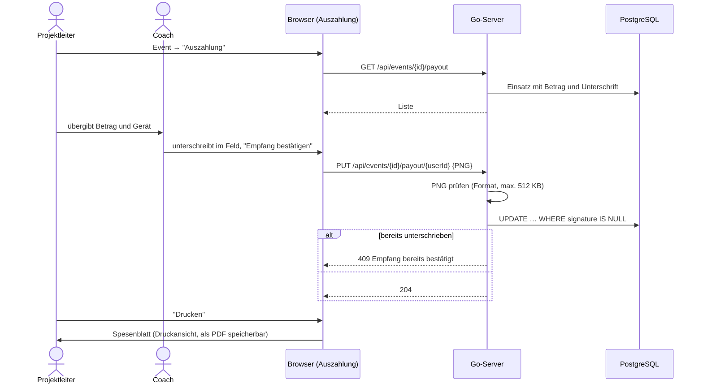

# Architektur

Überblick über den Aufbau der Applikation: Systemübersicht, Anwendungsfälle, Datenmodell und die wichtigsten Abläufe.
Die Diagramme sind in [Mermaid](https://mermaid.js.org) geschrieben und werden auf GitHub und in VS Code (Markdown-Vorschau) direkt dargestellt.

## Systemübersicht

- Ein einziger Go-Prozess liefert das gebaute Frontend aus und stellt die API bereit.
- Die Datenbank wird beim Start migriert (`api/internal/db/migrations`).
- Angemeldet wird über Google. Die Session liegt in einem HttpOnly-Cookie, in der Datenbank wird nur ein HMAC des Tokens gespeichert.
- Rollen werden pro Route im Server geprüft (`route(...)` in `server.go`), das Frontend blendet nur aus, was nicht erlaubt ist.

## Anwendungsfälle

Jede Rolle kann alles, was die Rolle darunter kann (Teilnehmer < Mitarbeiter < Projektleiter < Admin).
Pro Rolle sind nur die Anwendungsfälle aufgeführt, die neu dazukommen.

¹ Standard: Projektleiter. Admins legen unter Administration fest, welche weiteren Rollen und Funktionen (z.B. SC) Zugriff haben. Admins haben immer Zugriff, Teilnehmer nie.

## Datenmodell

- **Gäste** sind normale Benutzer mit `guest = true`. Meldet sich jemand mit derselben Email über Google an, übernimmt er das Konto.
- **Gelöschte Konten**: Check-ins bleiben mit `user_id = NULL` für die Statistik erhalten, alles andere wird gelöscht.
- **Einsatz** (`event_staff`): Funktion und Betrag werden beim Einteilen kopiert, damit spätere Lohnänderungen vergangene Events nicht verändern. Die Unterschrift der Auszahlung gehört zur selben Zeile.
- **Admins** haben immer Zugriff auf Notfallkontakte und stehen deshalb nicht in `emergency_access_roles`.

## Abläufe

### Anmeldung mit Google

Login mit Apple (optional) läuft gleich ab, mit diesen Unterschieden:

- Apple schickt das Resultat per `POST /api/auth/apple/callback` (`form_post`) von `appleid.apple.com`.
  Die Route ist deshalb vom CSRF-Schutz ausgenommen, State- und Nonce-Cookie sind `SameSite=None`
- Statt PKCE bindet eine Nonce im `id_token` den Code an den Browser
- Das Client-Secret ist ein JWT, das der Server bei jeder Anmeldung mit dem `.p8`-Schlüssel signiert
- Statt Userinfo liefert das `id_token` vom Token-Endpunkt `sub` und Email, der Name kommt nur bei der ersten Anmeldung
- Gesucht wird über `apple_sub` oder die Email. Gleiche Email wie bei Google: dasselbe Konto

### Check-in per QR-Code

### Auszahlung mit Unterschrift

## Leistung

Bei der Optimierung berücksichtigte Punkte, damit sie bei Änderungen erhalten bleiben:

- **IDs direkt vergleichen**: Benutzer-IDs werden in SQL mit der uuid-Spalte verglichen (`id = $1`), nie als Text (`id::text = $1`), sonst kann Postgres den Index nicht nutzen. Ungültige IDs fängt `validUUID` vorher ab.
- **Index `checkins (event_id)`**: wird von Eventliste, Teilnehmerliste und Bericht verwendet. Der Unique-Index auf `(event_id, user_id)` gilt nur für Zeilen mit Benutzer und hilft hier nicht.
- **Einsatz speichern**: alle gewählten Personen in einer Abfrage laden, die Einträge als Batch schreiben.
- **Frontend**: Dateien in `/assets/` werden einmal komprimiert (gzip) und im Speicher gehalten, der Browser speichert sie dauerhaft. Die QR-Seiten (Scanner, QR-Code) werden erst bei Bedarf geladen.
