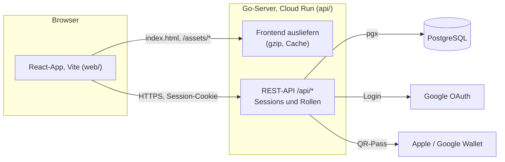
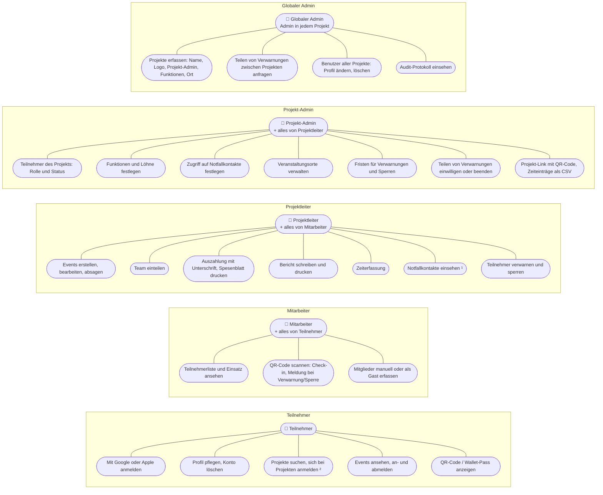
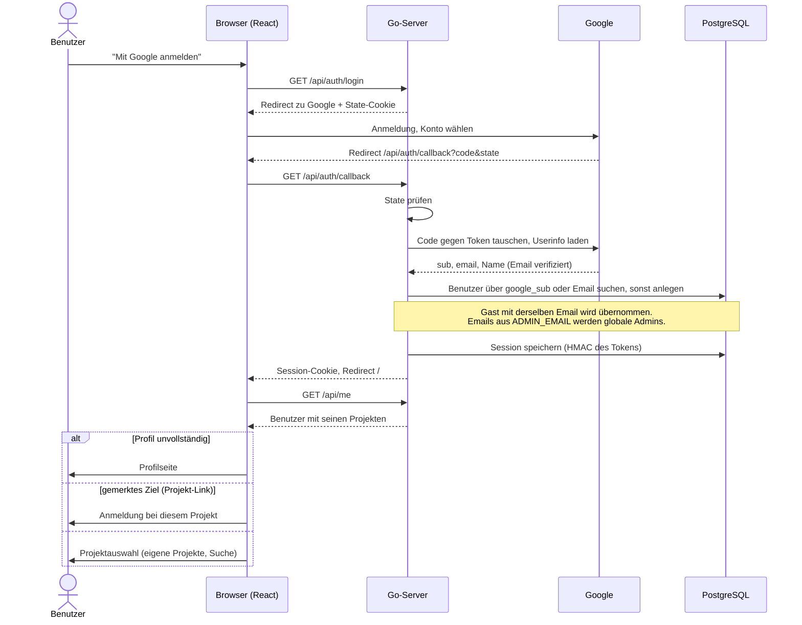
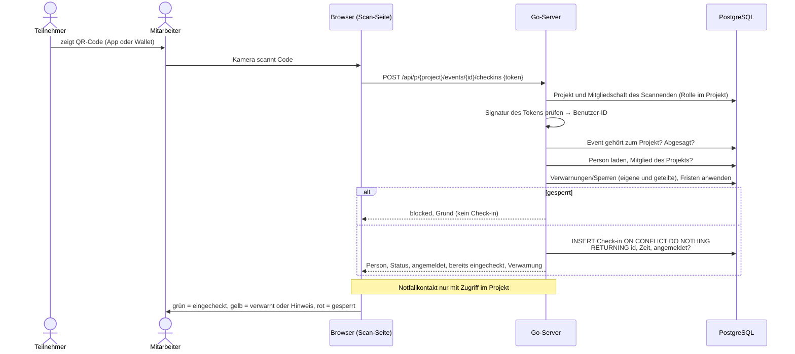
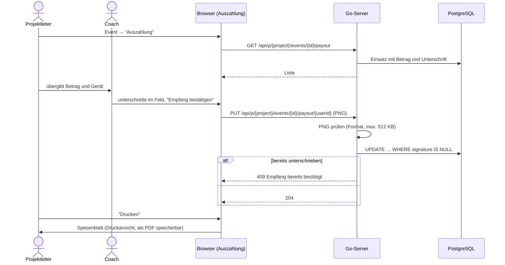
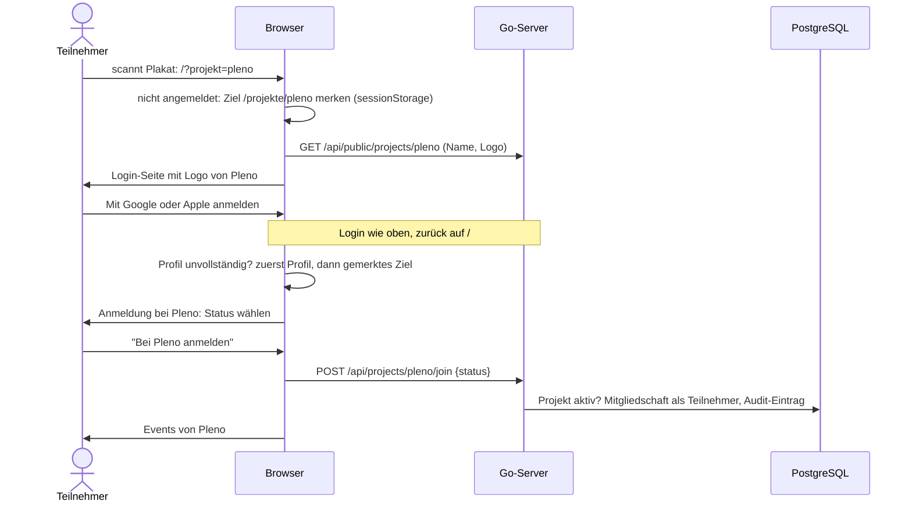
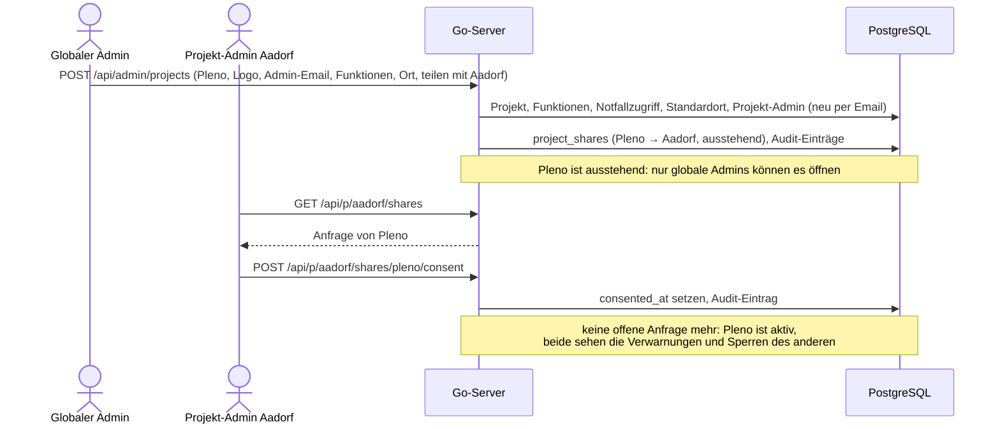

# Architektur

Überblick über den Aufbau der Applikation: Systemübersicht, Anwendungsfälle, Datenmodell und die wichtigsten Abläufe.
Die Diagramme sind in [Mermaid](https://mermaid.js.org) geschrieben und werden auf GitHub und in VS Code (Markdown-Vorschau) direkt dargestellt.

## Systemübersicht

- Ein einziger Go-Prozess liefert das gebaute Frontend aus und stellt die API bereit.
- Die Datenbank wird beim Start migriert (`api/internal/db/migrations`).
- Angemeldet wird über Google oder Apple. Die Session liegt in einem HttpOnly-Cookie, in der Datenbank wird nur ein HMAC des Tokens gespeichert.
- **Mandantenfähig**: Jedes Projekt (z.B. Midnightsports Aadorf, Pleno) hat eigene Events, Orte, Funktionen, Mitglieder,
  Verwarnungen und Einstellungen. Personen und ihr Profil sind global, Rolle, Status und Funktion gelten pro Projekt.
- Routen und Rollen prüft der Server (`server.go`), das Frontend blendet nur aus, was nicht erlaubt ist:
  - `route(...)`: angemeldet, unabhängig vom Projekt (Profil, QR-Code, Projekte suchen und anmelden)
  - `adminRoute(...)`: nur globale Admins (`/api/admin/...`: Projekte, Benutzer, Audit)
  - `projectRoute(...)`: im Projekt (`/api/p/{project}/...`). Lädt Projekt und Mitgliedschaft (`loadMember`) und prüft die
    Rolle **in diesem Projekt**. Daten anderer Projekte gelten als nicht gefunden (jede Abfrage filtert nach `project_id`)

## Anwendungsfälle

Rollen gelten pro Projekt. Jede Rolle kann alles, was die Rolle darunter kann
(Teilnehmer < Mitarbeiter < Projektleiter < Projekt-Admin). Der globale Admin ist in jedem Projekt Projekt-Admin
und verwaltet zusätzlich die Plattform. Pro Rolle sind nur die Anwendungsfälle aufgeführt, die neu dazukommen.

¹ Standard: Projektleiter. Projekt-Admins legen unter Administration fest, welche weiteren Rollen und Funktionen
(z.B. SC) Zugriff haben. Projekt-Admins haben immer Zugriff, Teilnehmer nie. Jeder Abruf wird protokolliert.

² Über die Startseite (Suche) oder den Projekt-Link `/?projekt=<kurzname>` (z.B. als QR-Code auf einem Plakat).
Den Status (Schüler/in aus der Region oder Gast extern) wählt die Person beim Anmelden.

## Datenmodell

Das Schema steht in `api/internal/db/migrations/001_init.sql`. Midnightsports Aadorf ist dort als erstes Projekt angelegt
(Funktionen, Orte, Zugriff auf Notfallkontakte).

```mermaid
erDiagram
    users ||--o{ sessions : "hat"
    projects ||--o{ project_members : "Mitglieder"
    users ||--o{ project_members : "ist Mitglied"
    functions |o--o{ project_members : "Funktion im Team"
    projects ||--o{ functions : "eigene Funktionen"
    projects ||--o{ locations : "eigene Orte"
    projects ||--o{ events : "eigene Events"
    projects ||--o{ emergency_access_roles : "Zugriff auf Notfallkontakte"
    functions ||--o| emergency_access_functions : "Zugriff auf Notfallkontakte"
    projects ||--o{ project_shares : "teilt Verwarnungen mit (partner_id)"
    projects ||--o{ sanctions : "verwarnt / sperrt"
    users ||--o{ sanctions : "betroffen"
    locations ||--o{ events : "findet statt in"
    users |o--o{ events : "verantwortlich (leader_id)"
    events ||--o{ event_staff : "Einsatz"
    users ||--o{ event_staff : "eingeteilt"
    functions ||--o{ event_staff : "Funktion beim Einsatz"
    events ||--o{ registrations : "Anmeldungen"
    users ||--o{ registrations : "meldet sich an"
    events ||--o{ checkins : "vor Ort"
    users |o--o{ checkins : "eingecheckt (NULL = gelöscht)"
    events ||--o| reports : "Bericht"
    projects ||--o{ time_entries : "Zeiterfassung"
    users ||--o{ time_entries : "erfasst"
    events |o--o{ time_entries : "optional zu Event"
    projects |o--o{ audit_log : "betrifft Projekt"

    users {
        uuid id PK
        text email UK "NULL bei Gästen ohne Email"
        text google_sub UK
        text apple_sub UK
        bool guest
        bool global_admin "Emails aus ADMIN_EMAIL"
        text first_name
        text last_name
        date birth_date
        text gender "w, m, d"
        text zip
        text city
        text emergency_name
        text emergency_phone
        text emergency_relation "vater, mutter, andere"
    }
    sessions {
        bytea token_hash PK "HMAC des Tokens"
        uuid user_id FK
        timestamptz expires_at
    }
    projects {
        int id PK
        text slug UK "Kurzname in der URL"
        text name
        text region "für Schüler-/in aus <region>"
        text description
        bytea logo "PNG, JPEG, WebP, NULL = Standardlogo"
        int ban_days "Frist Sperre, NULL = unbefristet"
        text ban_action "entsperren, verwarnen"
        int warning_days "Frist Verwarnung, NULL = unbefristet"
    }
    project_shares {
        int project_id PK, FK "anfragendes Projekt"
        int partner_id PK, FK "muss einwilligen"
        timestamptz consented_at "NULL = ausstehend"
        uuid consented_by FK
        timestamptz declined_at
    }
    project_members {
        int project_id PK, FK
        uuid user_id PK, FK
        text role "admin, projektleiter, mitarbeiter, teilnehmer"
        int function_id FK "Funktion desselben Projekts"
        text status "schueler, gast_extern, mitarbeiter"
        timestamptz joined_at
    }
    functions {
        int id PK
        int project_id FK
        text name "UK pro Projekt, z.B. JC, JSC, SC, PL"
        numeric salary "NULL = über Zeiterfassung"
    }
    emergency_access_roles {
        int project_id PK, FK
        text role PK "projektleiter, mitarbeiter"
    }
    emergency_access_functions {
        int function_id PK, FK
    }
    locations {
        int id PK
        int project_id FK
        text name
        text street
        text zip
        text city
        bool is_default "genau ein Standardort pro Projekt"
    }
    events {
        int id PK
        int project_id FK
        timestamptz starts_at
        timestamptz ends_at
        int location_id FK "Ort desselben Projekts"
        uuid leader_id FK
        bool cancelled
        uuid created_by FK
    }
    event_staff {
        int event_id PK, FK
        uuid user_id PK, FK
        int function_id FK "beim Einteilen festgehalten"
        numeric salary "beim Einteilen festgehalten"
        bytea signature "PNG, Empfang bestätigt"
        timestamptz signed_at
        uuid signed_by FK
    }
    registrations {
        int event_id PK, FK
        uuid user_id PK, FK
        timestamptz created_at
    }
    checkins {
        int id PK
        int event_id FK
        uuid user_id FK
        timestamptz checked_in_at
        uuid checked_in_by FK
    }
    reports {
        int event_id PK, FK
        text body
        uuid author_id FK
        timestamptz updated_at
    }
    time_entries {
        int id PK
        int project_id FK
        uuid user_id FK
        date date
        numeric hours
        text description
        int event_id FK
    }
    sanctions {
        int project_id PK, FK "auslösendes Projekt"
        uuid user_id PK, FK
        text level "verwarnung, sperre"
        text reason
        uuid created_by FK
        timestamptz created_at "Beginn der Frist"
    }
    audit_log {
        bigint id PK
        timestamptz at
        uuid actor_id "ohne FK, überdauert Löschung"
        text actor_name
        int project_id FK
        text action
        uuid target_user_id "ohne FK"
        text target_name
        jsonb details
    }
```

- **Personen sind global**: Profil, Login und QR-Code gelten für alle Projekte. Rolle, Funktion und Status gehören zur
  Mitgliedschaft (`project_members`). Eine Person kann in Aadorf Teilnehmerin und in Pleno Mitarbeiterin sein.
- **Projekt-Grenzen in der Datenbank**: Orte und Funktionen haben zusammengesetzte Fremdschlüssel `(project_id, id)`,
  ein Event kann nur einen Ort, ein Mitglied nur eine Funktion desselben Projekts haben.
- **Gäste** sind normale Personen mit `guest = true` und werden beim Erfassen Mitglied des Projekts. Meldet sich jemand
  mit derselben Email über Google oder Apple an, übernimmt er das Konto. Dasselbe gilt für Projekt-Admins, die der
  globale Admin beim Onboarding per Email anlegt.
- **Gelöschte Konten**: Check-ins bleiben mit `user_id = NULL` für die Statistik erhalten, alles andere wird gelöscht.
  Im Audit-Protokoll wird der Name durch «Gelöschtes Konto» ersetzt, die ID bleibt als Pseudonym.
- **Einsatz** (`event_staff`): Funktion und Betrag werden beim Einteilen kopiert, damit spätere Lohnänderungen vergangene
  Events nicht verändern. Die Unterschrift der Auszahlung gehört zur selben Zeile.
- **Projekt-Admins** und globale Admins haben immer Zugriff auf Notfallkontakte und stehen deshalb nicht in
  `emergency_access_roles`.

### Verwarnungen und Sperren

- Höchstens eine Verwarnung oder Sperre pro Person und Projekt. Eine neue ersetzt die bisherige, die Frist beginnt neu.
- **Verwarnt**: Check-in ist möglich, das scannende Gerät (und der manuelle Check-in) zeigt eine gelbe Meldung mit Grund.
- **Gesperrt**: kein Check-in (rote Meldung), keine Anmeldung zu Events.
- **Fristen** (Administration des Projekts): nach `ban_days` wird eine Sperre aufgehoben oder zur Verwarnung, nach
  `warning_days` eine Verwarnung gelöscht. Berechnet wird beim Lesen (`effectiveSanction` in `sanctions.go`), es gibt
  keinen Hintergrundjob. Eine Verwarnung nach einer Sperre zählt ab dem Ende der Sperre. Geänderte Fristen gelten auch
  für bestehende Einträge, es gelten immer die Fristen des auslösenden Projekts.
- **Sichtbar** nur im auslösenden Projekt und in Partnerprojekten mit eingewilligtem Teilen (`project_shares`).
  Ändern oder aufheben kann sie nur das auslösende Projekt.

### Teilen zwischen Projekten

- Der globale Admin legt beim Erstellen eines Projekts (z.B. Pleno) fest, mit welchen bestehenden Projekten
  (z.B. Midnightsports Aadorf) Verwarnungen und Sperren geteilt werden.
- Bis der Projekt-Admin jedes Partners eingewilligt hat, ist das neue Projekt **ausstehend**: nur globale Admins können
  es öffnen, es erscheint nicht in der Suche, niemand kann sich anmelden. Die Liste der globalen Administration zeigt
  den Stand pro Partner.
- Lehnt der Partner ab, bleibt das Projekt ausstehend, bis der globale Admin die Anfrage entfernt.
- Ein eingewilligtes Teilen können beide Projekt-Admins beenden.

### Audit-Protokoll

`audit_log` hält fest, wer wann was mit wessen Daten gemacht hat. Einträge werden in derselben Transaktion geschrieben
wie die Änderung (ohne Eintrag keine Änderung). Einsehen kann es nur der globale Admin (Administration → Audit).

| Aktion | Wann |
|---|---|
| `notfallkontakt.angesehen` | jeder Abruf eines Notfallkontakts (Teilnehmerliste) |
| `profil.angesehen`, `profil.geaendert` | globaler Admin öffnet bzw. ändert ein Profil (nur die geänderten Felder, keine Werte) |
| `benutzer.geloescht`, `konto.geloescht` | Löschung durch den globalen Admin bzw. durch die Person selbst |
| `mitglied.angemeldet`, `mitglied.rolle`, `mitglied.status`, `mitglied.funktion` | Anmeldung bei einem Projekt, Änderungen an Rolle, Status, Funktion (vorher/nachher) |
| `gast.erfasst` | Gast beim Check-in erfasst |
| `sanktion.erfasst`, `sanktion.aufgehoben`, `sanktion.fristen` | Verwarnungen, Sperren und ihre Fristen |
| `notfallzugriff.geaendert` | wer Notfallkontakte sehen darf |
| `export` | Export von Personendaten (Zeiterfassung als CSV) |
| `projekt.erstellt`, `projekt.geaendert` | Onboarding und Änderungen eines Projekts |
| `teilen.angefragt`, `teilen.eingewilligt`, `teilen.abgelehnt`, `teilen.entfernt` | Teilen von Verwarnungen zwischen Projekten |

Die Auswahl orientiert sich an der Rechenschaftspflicht und Protokollierung im Datenschutzrecht (revDSG mit DSV Art. 4,
DSGVO Art. 5 Abs. 2) für Daten Minderjähriger. **Offen und vor dem Betrieb zu klären**: rechtliche Prüfung der Auswahl,
Aufbewahrungsdauer und Löschung alter Einträge, Einwilligung bzw. Information der Eltern bei Kindern unter 16 Jahren.

## Abläufe

### Anmeldung mit Google

Login mit Apple (optional) läuft gleich ab, mit diesen Unterschieden:

- Apple schickt das Resultat per `POST /api/auth/apple/callback` (`form_post`) von `appleid.apple.com`.
  Die Route ist deshalb vom CSRF-Schutz ausgenommen, State- und Nonce-Cookie sind `SameSite=None`
- Statt PKCE bindet eine Nonce im `id_token` den Code an den Browser
- Das Client-Secret ist ein JWT, das der Server bei jeder Anmeldung mit dem `.p8`-Schlüssel signiert
- Statt Userinfo liefert das `id_token` vom Token-Endpunkt `sub` und Email, der Name kommt nur bei der ersten Anmeldung
- Gesucht wird über `apple_sub` oder die Email. Gleiche Email wie bei Google: dasselbe Konto

### Check-in per QR-Code

### Auszahlung mit Unterschrift

### Anmeldung bei einem Projekt (Projekt-Link)

### Projekt erstellen mit geteilten Verwarnungen

## Migration der bestehenden Daten (offen)

Auf dem Branch `feat/multitenancy` ist das Schema neu (`001_init.sql`). Die Übernahme der Daten aus der bisherigen
Produktion wird erst nach dem Merge geplant. Zu berücksichtigen:

- Alle bisherigen Daten gehören zu Midnightsports Aadorf (`project_id` des Projekts `aadorf`)
- `users.role`, `users.function_id` und `users.status` werden zu `project_members` von Aadorf
  (`schueler_aadorf` → `schueler`), Admins zu Projekt-Admins von Aadorf, `ADMIN_EMAIL` zu globalen Admins
- Funktionen, Orte, Zugriff auf Notfallkontakte und Zeiteinträge erhalten die `project_id` von Aadorf
- Vorgehen (Export/Import in eine neue Instanz oder Migration `002_…` auf der bestehenden) und Test mit einer
  Kopie der Produktion (PITR-Klon) sind noch zu entscheiden

## Leistung

Bei der Optimierung berücksichtigte Punkte, damit sie bei Änderungen erhalten bleiben:

- **Mitgliedschaft in einer Abfrage**: `loadMember` lädt Projekt, Rolle, Status und Zugriff auf Notfallkontakte zusammen,
  pro Request im Projekt also zwei Abfragen (Session, Mitgliedschaft).
- **Verwarnungen gesammelt laden**: `visibleSanctions` lädt sie für alle Personen einer Liste in einer Abfrage.
- **IDs direkt vergleichen**: Benutzer-IDs werden in SQL mit der uuid-Spalte verglichen (`id = $1`), nie als Text (`id::text = $1`), sonst kann Postgres den Index nicht nutzen. Ungültige IDs fängt `validUUID` vorher ab.
- **Index `checkins (event_id)`**: wird von Eventliste, Teilnehmerliste und Bericht verwendet. Der Unique-Index auf `(event_id, user_id)` gilt nur für Zeilen mit Benutzer und hilft hier nicht.
- **Einsatz speichern**: alle gewählten Personen in einer Abfrage laden, die Einträge als Batch schreiben.
- **Frontend**: Dateien in `/assets/` werden einmal komprimiert (gzip) und im Speicher gehalten, der Browser speichert sie dauerhaft. Die QR-Seiten (Scanner, QR-Code) werden erst bei Bedarf geladen.
