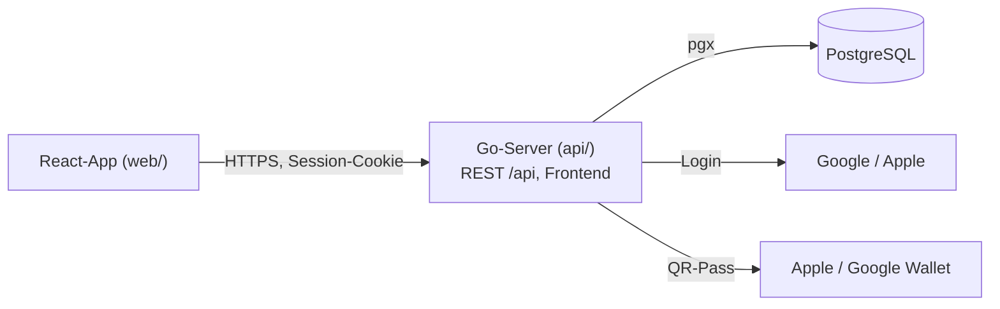
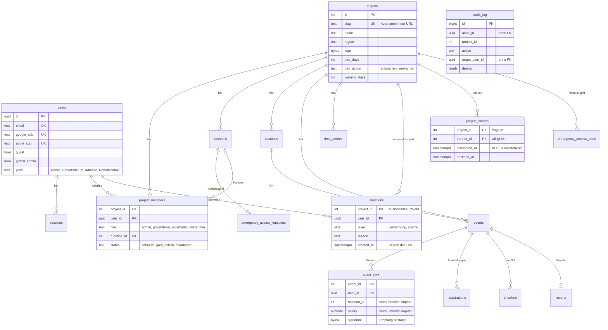
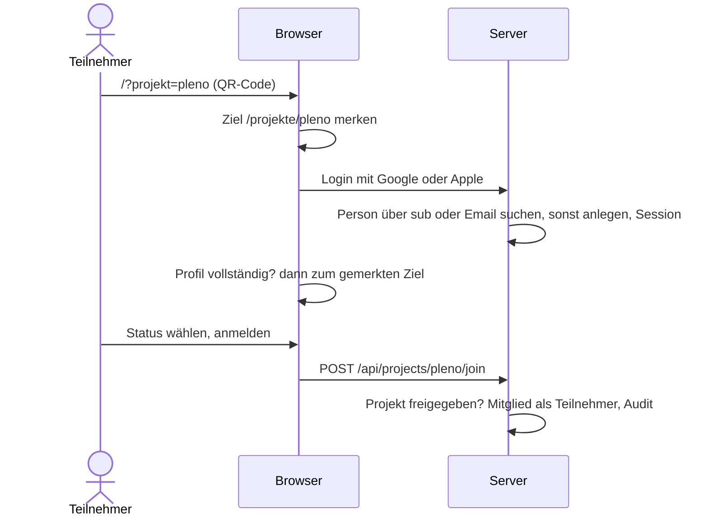
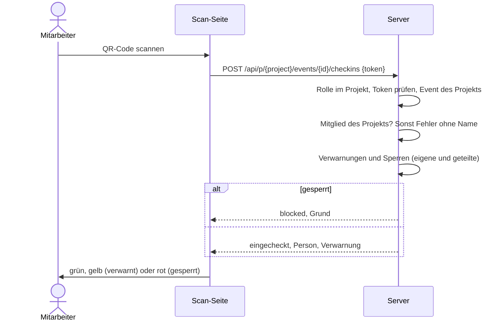

# Architektur

Diagramme in [Mermaid](https://mermaid.js.org), dargestellt auf GitHub und in VS Code.

## Übersicht

- Ein Go-Prozess liefert Frontend und API aus, migriert die Datenbank beim Start (`api/internal/db/migrations`).
- Session als HttpOnly-Cookie, in der Datenbank nur ein HMAC des Tokens.
- **Mandanten**: Jedes Projekt (z.B. Midnightsports Aadorf, Pleno) hat eigene Events, Orte, Funktionen, Mitglieder,
  Verwarnungen und Einstellungen. Personen und Profil sind global, Rolle, Status und Funktion gelten pro Projekt.
- Routen in `server.go`, der Server prüft jede Rolle:
  - `route`: angemeldet, ohne Projekt (Profil, QR-Code, Projekte suchen und anmelden)
  - `adminRoute`: globale Admins (`/api/admin/...`)
  - Projekt-Routen `/api/p/{project}/...`: `loadMember` lädt Projekt und Mitgliedschaft, Rolle gilt in diesem Projekt

## Rollen

Pro Projekt, jede Rolle kann alles der Rollen darüber.

| Rolle | Kann |
|---|---|
| Teilnehmer | Profil, Projekte suchen und beitreten, Events an- und abmelden, QR-Code und Wallet-Pass |
| Mitarbeiter | Teilnehmerliste, Check-in (Scan oder manuell), Gäste erfassen |
| Projektleiter | Events erfassen, Team, Auszahlung, Bericht, Zeiterfassung, Notfallkontakte¹, verwarnen und sperren |
| Projekt-Admin | Rollen und Status, Funktionen und Löhne, Notfallzugriff, Orte, Fristen, Einwilligung zum Teilen, Projekt-Link |
| Globaler Admin | In jedem Projekt Admin. Projekte erfassen, Personen bearbeiten und löschen, Audit-Protokoll |

¹ Standard: Projektleiter. Projekt-Admins wählen weitere Rollen und Funktionen, Teilnehmer nie.

## Datenmodell

Schema: `api/internal/db/migrations/001_init.sql`, mit Midnightsports Aadorf als erstem Projekt.

## Regeln

**Mandantentrennung**
- Jede Abfrage in einem Projekt-Handler filtert nach `project_id` oder über einen Event des Projekts
  (`loadEvent`, `projectEvent`, `projectMemberUser`). Daten anderer Projekte ergeben 404.
- Orte und Funktionen haben Fremdschlüssel `(project_id, id)`: Events und Mitglieder können nur Orte und
  Funktionen des eigenen Projekts verwenden.
- Personen anderer Projekte werden nicht geladen, auch nicht ihr Name (z.B. beim Check-in per ID).
- Nicht freigegebene Projekte (Teilen noch nicht eingewilligt) sind nur für globale Admins erreichbar, auch das Logo.

**Personen**
- Gäste: Person mit `guest = true`, Mitglied des Projekts. Login mit derselben Email übernimmt das Konto,
  ebenso bei Projekt-Admins, die beim Onboarding per Email angelegt werden.
- Löschen: Check-ins bleiben mit `user_id = NULL`, im Audit wird der Name durch „Gelöschtes Konto“ ersetzt.

**Einsatz**: Funktion und Betrag werden beim Einteilen kopiert, spätere Lohnänderungen ändern vergangene Events nicht.

**Verwarnungen und Sperren**
- Eine pro Person und Projekt, eine neue ersetzt die bisherige.
- Verwarnt: Check-in mit gelber Meldung. Gesperrt: kein Check-in, keine Event-Anmeldung.
- Fristen des auslösenden Projekts werden beim Lesen angewendet (`effectiveSanction`).
- Sichtbar im auslösenden Projekt und in Partnerprojekten mit Einwilligung, ändern nur im auslösenden.

**Teilen**: Der globale Admin fragt beim Erstellen eines Projekts an. Bis jeder Partner-Admin eingewilligt hat,
ist das neue Projekt nicht freigegeben. Abgelehnte Anfragen entfernt der globale Admin.

**Audit** (`audit_log`, nur globale Admins): Einträge in derselben Transaktion wie die Änderung. Protokolliert:
Notfallkontakt und Profil angesehen, Profil geändert (nur Feldnamen), Löschungen, Anmeldung bei Projekten,
Rolle, Status, Funktion, Gäste, Verwarnungen und Fristen, Notfallzugriff, Exporte, Projekte, Teilen.
Offen: rechtliche Prüfung (revDSG, DSGVO), Aufbewahrungsdauer, Einwilligung der Eltern unter 16.

## Abläufe

### Anmeldung über den Projekt-Link

### Check-in

## Migration der bestehenden Daten (offen)

Auf `feat/multitenancy` ist das Schema neu. Die Übernahme der Produktion wird nach dem Merge geplant:
alle Daten zu Aadorf, `users.role/function_id/status` zu `project_members` (`schueler_aadorf` zu `schueler`),
`ADMIN_EMAIL` zu globalen Admins. Vorgehen und Test mit einem PITR-Klon noch zu entscheiden.

## Leistung

- Pro Projekt-Request zwei Abfragen: Session und Mitgliedschaft (`loadMember`).
- Verwarnungen einer Liste in einer Abfrage (`visibleSanctions`), Einsatz als Batch.
- UUIDs direkt vergleichen (`id = $1`), nie `id::text`, sonst kein Index.
- `/assets/` einmal gzip-komprimiert und dauerhaft gecacht, QR-Seiten und Administration erst bei Bedarf geladen.
